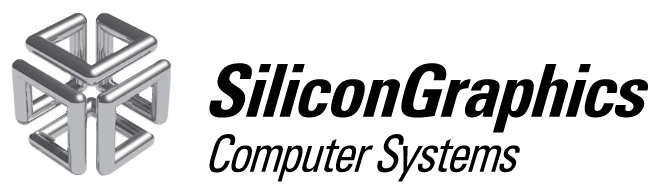
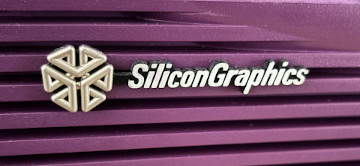

## SGI - Indigo 2

3D-printed spare parts for the Silicon Graphics Indigo2

### Infinity cube + SiliconGraphics badge for Indigo2

This is a replacement 'Infinity cube + SiliconGraphics' badge for the Indigo2, both teal and purple.

[badge-indigo2.stl](badge-indigo2.stl)

3D print settings:

- Use a resin printer!
- Use black resin
- Sand it with sandpaper and then paint with a 'Liquid Chrome' pen. 

