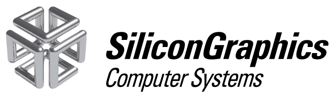

## SGI - O2

3D-printed spare parts for Silicon Graphics machines

### O2 CD-ROM eject button rod

Contributed by stormy.

[o2 eject rod.stl](o2 eject rod.stl)
[o2 eject box.stl](o2 eject box.stl)

Eject rod for CD-ROM drives which don't have the special front bezel which allows for the eject button to work.

