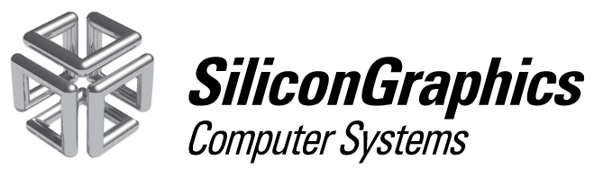

# SGI-3DPrint

3D-printed spare parts for SGI - Silicon Graphics Computer Systems

## Iris Indigo

- [Front Lid Clips](Indigo/front-lid/)

## Indigo 2

- [Front Lid Clips](Indigo2/front-lid/)
- [Front Cover Clips](Indigo2/front-cover/)
- [Badge for IMPACT 10000](Indigo2/badge-10000/)
- [GFX Badge: Extreme Power](Indigo2/power-extreme/)
- [SGI Badge](Indigo2/sgi-badge/)

## O2

- [Pull mechanism](O2/pull-mechanism/)

## Octane / Octane2

- [Front Door Fix](Octane/front-door/)
- [XIO parts](Octane/XIO/)
- [Drive sled by Xav101](https://www.thingiverse.com/thing:4064428)
- [Drive sled by HurricaneJames](https://www.thingiverse.com/thing:2512810)
- [PCI blanking plate by SYNTHTC](https://www.thingiverse.com/thing:4725514)

## Fuel

- [Front Door Latch](Fuel/door-latch/)

## Tezro (rack mounted)

- [Infinity cube](Tezro/RM/infinity-cube/)

## Accessories

- [Compression Connector Cap](accessories/comp-cap/)
- [Drive Bay Cover](accessories/drive-bay-cover/)

Contributors: flexion, cz7asm, jrha

