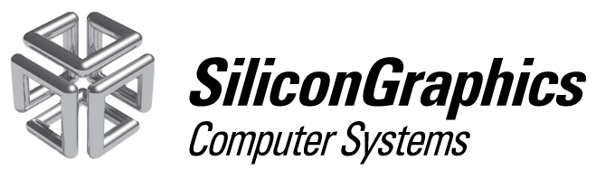
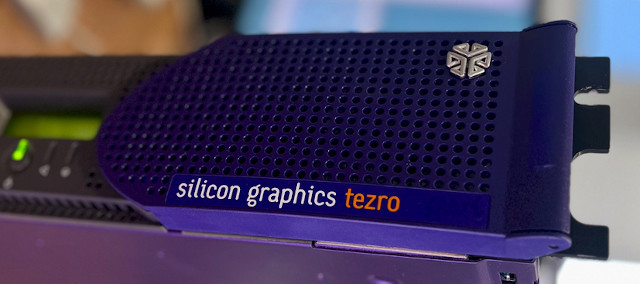

## SGI - Tezro

3D-printed spare parts for the Silicon Graphics Tezro

### Infinity cube badge for Tezro RM

(image courtesy of CB_HK)

Infinity cube logo for the rackmount Tezro. 

[tezro-RM-cube.stl](tezro-RM-cube.stl)

[tezro-RM-cube-cap.stl](tezro-RM-cube-cap.stl)

3D print settings:

- Use a resin printer
- Black resin
- Sand it with sandpaper and then paint with a 'Liquid Chrome' pen.

